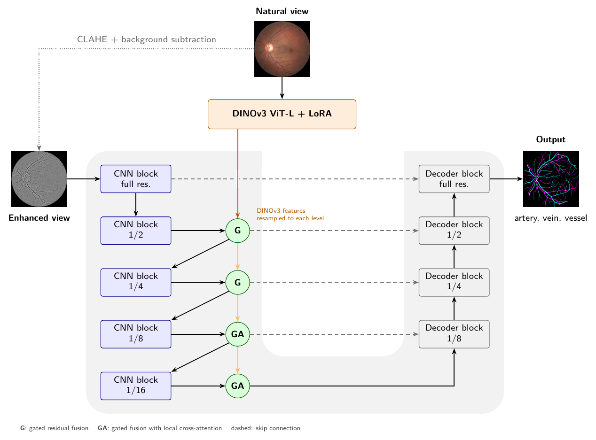
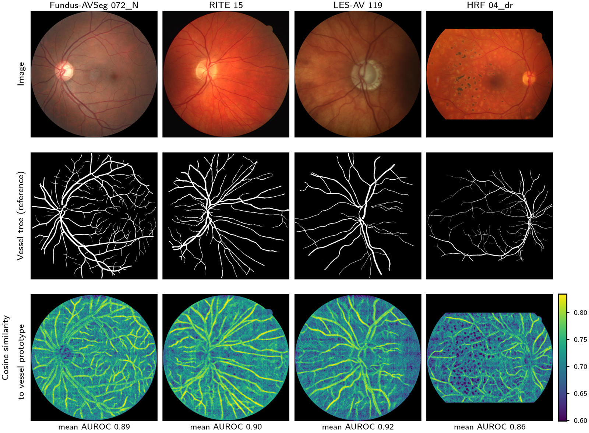

# DualView

**Combining a convolutional network and a vision transformer for artery–vein segmentation that generalizes across fundus datasets**

Vinicius de Carvalho Rispoli, Alan Müller, Thiago Alves Martins, Ronni Amorim, Marília Miranda Forte Gomes and Rodolfo Deusdará
University of Brasília, Brazil

DualView is a U-shaped network for the segmentation and artery/vein (A/V) classification of retinal vessels in color fundus
photographs. A convolutional encoder processes a contrast-enhanced view of the photograph at full resolution, while a DINOv3
vision transformer, adapted with low-rank adapters (LoRA), processes the natural view. The two representations are fused at
four encoder levels. The network outputs three independent maps (artery, vein and vessel tree).



The motivation is shown below. Without any training on fundus images, DINOv3 features already distinguish the vessel tree
from the background in four public datasets, while the convolutional stream delineates the vessels at full resolution.



## Main results

A/V accuracy (Intersection mode of the official RRWNet evaluation code, in %). DualView never sees RITE, LES-AV or HRF during
training. RRWNet and RRWNet + C³ are the published results of models trained on RITE or HRF (and on RITE for LES-AV).

| Test set | RRWNet | RRWNet + C³ | DualView (Fundus-AVSeg) | DualView (Fundus-AVSeg + RAV) |
|---|---|---|---|---|
| RITE | 96.66 | 96.77 | 96.40 | **97.48** |
| LES-AV | 94.81 | 95.18 | 95.82 | **96.53** |
| HRF | 97.83 | **98.28** | 97.57 | 97.60 |

On Fundus-AVSeg, DualView reaches artery and vein Dice of 90.3% and 91.7%, which is 4.6 and 4.4 percentage points higher
than RRWNet retrained on the same folds. The paper also reports vessel segmentation, Dice and connectivity on all datasets.

## Installation

```bash
git clone https://github.com/labviaunb/dualview.git
cd dualview
pip install -e .
```

DualView uses the DINOv3 ViT-L/16 backbone from the Hugging Face Hub
([facebook/dinov3-vitl16-pretrain-lvd1689m](https://huggingface.co/facebook/dinov3-vitl16-pretrain-lvd1689m)). Access to this
model requires accepting the DINOv3 license on its Hugging Face page. Then log in with `huggingface-cli login` or set the
`HF_TOKEN` environment variable.

## Usage

Segment one or more photographs with the four fold models trained on Fundus-AVSeg:

```bash
python -m dualview.predict photo1.png photo2.jpg --out results/
```

Use `--model fundus-avseg-rav` for the models trained on Fundus-AVSeg + RAV, which generalize better to other datasets (see
the license below). For each photograph, three files are written: the probabilities as an RGB image (red = artery,
green = vein, blue = vessel), the binary mask (artery in magenta, vein in cyan, crossing in white and vessel without A/V class
in blue) and an overlay on the photograph.

In Python:

```python
from dualview import DualViewPredictor
from dualview.preprocessing import load_image

predictor = DualViewPredictor('fundus-avseg')          # mean of the four fold models
prob, aperture = predictor(load_image('photo.png'))   # prob: (H, W, 3) = [artery, vein, vessel]
```

The photograph must have a dark surround, as usual in fundus cameras. The input field of view is estimated from the camera
aperture, and the square around it is resized to 1280 × 1280 pixels. The predictions are returned at the native resolution.
Inference takes about 1.2 s per image on a laptop with an Apple M3 Max processor.

## Released models

The weights are attached to the [v1.0 release](https://github.com/labviaunb/dualview/releases/tag/v1.0) and are downloaded
automatically on first use (to `~/.cache/dualview`, or to the folder set in `DUALVIEW_CACHE`). Each file holds only the trained
parameters (about 60 MB). The frozen DINOv3 backbone is loaded from the Hugging Face Hub.

| Models | Training set | Seeds | Folds | License |
|---|---|---|---|---|
| `fundus-avseg_seed{42,43,44}_fold{0..3}` | Fundus-AVSeg | 42, 43, 44 | 0 to 3 | MIT |
| `fundus-avseg-rav_seed42_fold{0..3}` | Fundus-AVSeg + RAV | 42 | 0 to 3 | CC BY-NC 4.0 |

Each file also records the Fundus-AVSeg images used for validation in its fold, so that the cross-validation of the paper can
be reproduced.

## Training

DualView is trained with 4-fold cross-validation on Fundus-AVSeg, whose images and annotations are distributed at
1280 × 1280 pixels. The folds are the same as in the paper (split seed 42), and each fold model is validated and selected on
the 25 Fundus-AVSeg images that it does not see during training.

```bash
python -m dualview.train --images Fundus-AVSeg/images --annotations Fundus-AVSeg/annotations --out runs/fundus-avseg
```

To add RAV to the training set of every fold, pass the dataset as downloaded (a folder with `rgb/` and `av_masks/`). It is
converted once to 1280 × 1280 and to the label convention of DualView, excluding three images whose labels are offset from
the vessels. The epoch counts are scaled so that the number of optimization steps stays the same.

```bash
python -m dualview.train --images Fundus-AVSeg/images --annotations Fundus-AVSeg/annotations \
    --rav-source RAV/dataset --rav-dir RAV_1280 --out runs/fundus-avseg-rav
```

Use `--seed` for the other training seeds of the paper (43 and 44) and `--folds` to train only some folds. Training is
resumed automatically if it is interrupted. At the end of each fold, the selected weights are written to
`<out>/dualview_<training set>_seed<seed>_fold<fold>.pt`, which can be passed to `dualview.predict --model`. In the paper,
each fold took about 2 to 4 hours on a single NVIDIA RTX PRO 6000 Blackwell GPU (96 GB).

## Evaluation

The evaluation protocol of the paper (official RRWNet metrics, Dice, connectivity and the comparison tables) will be added
to this repository.

## Citation

The paper is under review. Until it is published, please cite this repository.

```bibtex
@misc{rispoli2026dualview,
  title  = {DualView: combining a convolutional network and a vision transformer for artery--vein segmentation that
            generalizes across fundus datasets},
  author = {Rispoli, Vinicius de Carvalho and M{\"u}ller, Alan and Martins, Thiago Alves and Amorim, Ronni and
            Gomes, Mar{\'i}lia Miranda Forte and Deusdar{\'a}, Rodolfo},
  year   = {2026},
  url    = {https://github.com/labviaunb/dualview}
}
```

## License

The code is released under the MIT License (see `LICENSE`). The weights trained on Fundus-AVSeg are released under the same
license. The weights trained on Fundus-AVSeg + RAV are released under CC BY-NC 4.0, the license of the RAV dataset, and may
not be used for commercial purposes. In both cases, the use of the weights is also subject to the DINOv3 license and to the
terms of the training datasets.
